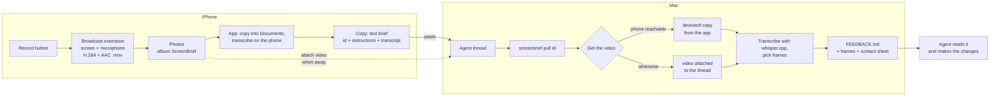

# ScreenBrief

Record your iPhone screen while you talk about what you want changed, tap **Copy**, and paste into your
coding agent's thread. The agent fetches the video and reads it as a timeline: what you said, next to
screenshots of what was on screen at that moment.

It was built for [T3 Code](https://github.com/pingdotgg/t3code) threads, for one person's use. The
copied text is plain, so any agent that can run a command on the Mac can follow it.

## Using it

1. Open ScreenBrief on the iPhone and tap **Start recording**. Tap **Start Sharing** in the system sheet
   (turn Microphone on the first time; iOS remembers it).
2. Switch to the app you are testing. Use it and say what you want changed.
3. Stop from the red status bar pill, or come back to ScreenBrief and tap the button again.
4. Open the recording in ScreenBrief, check the transcript, tap **Copy**.
5. Paste into the agent's thread. If the Mac cannot reach the phone (you are away from it), also attach
   the video from Photos, album "ScreenBrief". A recording over 50 MB is attached as its parts; the app
   says how many.

The agent runs `screenbrief pull <id>`, reads the `FEEDBACK.md` it prints, opens the frames, and makes
the changes. If it cannot get the video it is told to wait for you rather than guess from the transcript.

**Pasting from the field without the video.** Turn on the background check once with
`screenbrief watch --install`. A pull that cannot get the video is then remembered. When the iPhone is
next in reach of the Mac (unlocked, on the same Wi-Fi or plugged in), the Mac fetches and processes the
recording by itself and sends the waiting T3 Code thread a message with the `FEEDBACK.md` path, so the
agent carries on without you attaching anything. The check runs every two minutes and only reaches for
the phone while something is waiting. Getting the video across with no shared network at all is
[issue #4](https://github.com/RostyslavDzhohola/screenbrief/issues/4).

## How it works



- **iPhone app** (`ios/`). A ReplayKit broadcast upload extension records the whole screen and the
  microphone, also while other apps are in front, and writes one fragmented QuickTime movie
  (about 750 kbps, so about 5.6 MB a minute). When the broadcast stops it saves the movie to Photos.
  The app notices the new video, copies it into its own `Documents/Recordings/`, transcribes it on the
  phone, and shows a list with playback, the transcript and a **Copy** button.
- **The copied text** (`ios/ScreenBrief/Model/Brief.swift`) holds the recording id, the instruction
  `screenbrief pull <id>`, what to do when the video cannot be fetched, and the phone's transcript.
- **Mac CLI** (`mac/`, Node, no dependencies beyond ffmpeg and whisper.cpp). `screenbrief pull` looks
  for the video in two places:
  - on the iPhone, through the developer pairing Xcode already has with it (phone unlocked, on the same
    Wi-Fi as the Mac or plugged in);
  - among the files attached in T3 Code (`~/.t3/userdata/attachments`), matched by the title the
    recorder writes into each movie (`ScreenBrief-<id>`, or `ScreenBrief-<id>-part2of3` for a part),
    or for older recordings by the start time, which is also the id.

  It then transcribes with whisper.cpp, picks the frames that matter (the start of each spoken phrase,
  each screen change, each touch mark) and writes a bundle to `~/ScreenBrief/recordings/phone-<id>/`
  with `FEEDBACK.md`, `frames/`, a contact sheet and `recording.mp4`.
- **Touch overlay** (`overlays/`, optional). iOS does not show touches in a screen recording and does
  not let one app see touches in another. This is a debug-only component you add to the app you are
  testing; it draws taps, long presses and finger trails in magenta, and the Mac side turns them into
  timeline entries.

The extension and the app share no storage (there is no App Group): Photos is the hand-off, and a shared
Keychain item carries the recorder's heartbeat and diagnostics. There is no pairing step, and nothing
runs in the background on the Mac unless you turn on the optional check with `screenbrief watch --install`.

## Limits

- **About 8 minutes per file when you attach the video.** T3 Code attaches files up to 50 MB each.
  The app splits a longer recording into parts that fit (no re-encoding) and saves them to Photos next
  to the original; you attach all the parts and `screenbrief pull` joins them. In the Photos picker the
  parts are the shorter videos right after the full one. When the Mac can reach the phone it copies the
  whole recording and the parts are not needed.
- **Portrait.** The movie's orientation is fixed by its first frame. Turning the phone to landscape
  partway through leaves that stretch sideways.
- **Touches are not recorded** unless the app you are testing has the overlay.
- **A personal tool, opened up.** It was made for one phone and one Mac. You build the iPhone app
  yourself (see below); expect rough edges.

## Mac commands

```
screenbrief pull <id | latest>   # get a recording, process it, print the path of FEEDBACK.md
screenbrief process <video>      # process any video file the same way
screenbrief frames <bundle or id> --at 12.5     # extra frames around a moment
screenbrief watch --install      # fetch recordings a pull could not get, once the phone is in reach
screenbrief watch --status       # what is waiting; --uninstall turns the background check off
screenbrief doctor               # check ffmpeg, whisper, devicectl and the attachments folder
```

`pull` exits with status 2 and a message for the agent when it cannot get the video.

Setup: Node 24, `brew install ffmpeg whisper-cpp`, a whisper model at
`~/ScreenBrief/models/ggml-large-v3-turbo-q5_0.bin`, and `mac/bin/screenbrief` on the PATH (a symlink
in `/opt/homebrew/bin` works). `screenbrief doctor` checks all of it.

## Building the phone app

The app is not on the App Store: you build it with Xcode and your own Apple developer account.

```
brew install xcodegen                             # first: the script uses it to regenerate the Xcode project
scripts/set-identity.sh com.example ABCDE12345   # your bundle id prefix and 10-character team id
open ios/ScreenBrief.xcodeproj                    # pick your iPhone and Run
```

`set-identity.sh` replaces the original bundle id prefix in the project's own files (project settings,
entitlements, Swift sources, the Mac tool), sets your team, and switches to Xcode's automatic signing. It was checked
by building the result for the simulator; signing with another account has not been tried by the author.

From the command line, after editing `ios/project.yml`:

```
cd ios
xcodegen generate
xcodebuild build -project ScreenBrief.xcodeproj -scheme ScreenBrief \
  -destination 'generic/platform=iOS' -derivedDataPath /tmp/sb-dd-device
xcrun devicectl device install app --device <id from: xcrun devicectl list devices> \
  /tmp/sb-dd-device/Build/Products/Debug-iphoneos/ScreenBrief.app
```

As committed, `project.yml` names the author's team, bundle ids and provisioning profiles
("ScreenBrief Dev", "ScreenBrief Broadcast Dev", "ScreenBrief UITests Dev").

## Tests

```
cd mac && npm test
cd ios && xcodebuild test -project ScreenBrief.xcodeproj -scheme ScreenBrief \
  -destination 'platform=iOS Simulator,name=<a simulator>' -derivedDataPath /tmp/sb-dd
# On the real phone (drives the app with Xcode UI automation; the phone must be unlocked):
cd ios && xcodebuild test -project ScreenBrief.xcodeproj -scheme ScreenBriefDevice \
  -destination 'id=<iPhone UDID>' -derivedDataPath /tmp/sb-dd-device
```

ReplayKit does not run in the simulator, so recording itself is only tested on a real phone. One device
test (`testFullLoopIntoT3Code`) pastes into a T3 Code thread with a specific title; read it before
running it.
